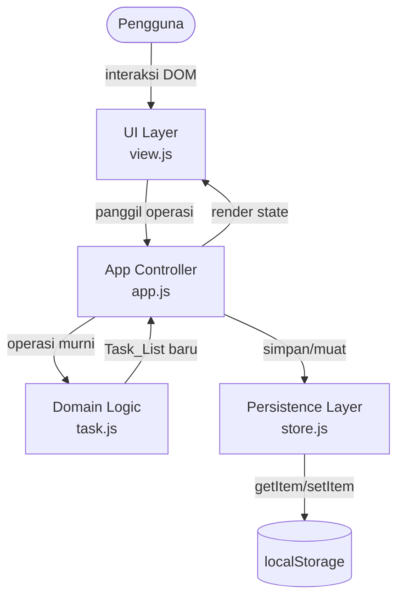

# Design Document

## Overview

Dokumen ini menjelaskan desain teknis untuk **Todo_App**, sebuah aplikasi todolist sederhana berbasis frontend yang berjalan sepenuhnya di peramban tanpa backend. Seluruh data tugas disimpan secara lokal menggunakan `localStorage` sehingga tetap bertahan setelah halaman dimuat ulang.

Sesuai kebutuhan "sederhana", desain menggunakan **vanilla JavaScript, HTML, dan CSS** tanpa framework. Alasannya:

- Ruang lingkup fitur kecil (tambah, lihat, toggle, edit, hapus, simpan lokal) sehingga framework akan menambah kompleksitas tanpa manfaat berarti.
- Tidak ada backend, routing, atau state global yang kompleks.
- Logika inti (validasi, operasi Task, serialisasi) dapat diisolasi sebagai fungsi murni (pure functions) yang mudah diuji dengan property-based testing.

Desain memisahkan tiga tanggung jawab utama:

1. **Logika domain murni** (model Task, validasi, operasi daftar) — tidak bergantung pada DOM maupun `localStorage`.
2. **Lapisan persistensi** (`Task_Store`) — membungkus `localStorage` dengan penanganan data rusak dan kegagalan kuota.
3. **Lapisan presentasi** (UI rendering + event handling) — menghubungkan DOM dengan logika domain.

Pemisahan ini membuat logika inti dapat diuji secara independen dari peramban, yang penting untuk strategi pengujian berbasis properti.

## Architecture

### Diagram Komponen



### Alur Data Utama

- **Unidirectional flow**: Event UI → Controller memanggil operasi domain murni → menghasilkan `Task_List` baru → Controller menyimpan via `Task_Store` → Controller memerintahkan UI me-render ulang dari state terbaru.
- State aplikasi (`Task_List`) dipegang sebagai satu sumber kebenaran (single source of truth) di dalam Controller. Operasi domain selalu menghasilkan `Task_List` baru (immutable update) alih-alih memodifikasi in-place, agar mudah diuji dan menghindari efek samping tak terduga.

### Tanggung Jawab Modul

| Modul | Tanggung jawab | Ketergantungan |
|-------|----------------|----------------|
| `task.js` (Domain) | Membuat Task, validasi Task_Text, operasi add/toggle/edit/delete pada Task_List, pembuatan id unik | Tidak ada (pure) |
| `store.js` (Persistence) | Serialisasi/deserialisasi Task_List ke/dari `localStorage`, penanganan data rusak dan kuota | `localStorage` |
| `view.js` (Presentation) | Render Task_List ke DOM, strikethrough, pemotongan teks tampilan, pesan kosong/error | DOM |
| `app.js` (Controller) | Orkestrasi: menyimpan state, menghubungkan event UI dengan domain dan store, memicu render | `task.js`, `store.js`, `view.js` |

### Pembagian File

```
todolist-app/
├── index.html      # Struktur halaman + kontainer UI
├── styles.css      # Gaya tampilan Neobrutalism (border tebal, hard shadow, warna kontras) termasuk kelas .completed (strikethrough)
└── src/
    ├── task.js     # Logika domain murni
    ├── store.js    # Lapisan persistensi localStorage
    ├── view.js     # Rendering DOM
    └── app.js      # Controller / entry point
```

## Components and Interfaces

### Domain Logic (`task.js`)

Berisi fungsi murni. Konstanta validasi:

- `MAX_TEXT_LENGTH = 50`
- `MIN_TEXT_LENGTH = 3`
- `MAX_TASKS = 1000`

Antarmuka (konseptual, JavaScript):

```javascript
// Hasil validasi terstruktur agar pesan error spesifik (Req 1.4, 1.5, 4.2)
// { ok: true, value: string } | { ok: false, reason: 'empty' | 'too_short' | 'too_long' }
function validateTaskText(rawText)

// Membuat Task baru dengan id unik; mengembalikan objek Task (Req 1.1, 1.2)
function createTask(trimmedText, existingIds)

// Menghasilkan id unik yang berbeda dari seluruh id pada existingIds (Req 1.2)
function generateId(existingIds)

// Mengembalikan Task_List BARU dengan task ditambahkan (Req 1.1)
function addTask(taskList, rawText)  // -> { ok, taskList?, reason? }

// Mengembalikan Task_List BARU dengan Completion_Status task ter-toggle (Req 3.1, 3.2)
function toggleTask(taskList, id)

// Mengembalikan Task_List BARU dengan Task_Text diperbarui; id & status dipertahankan (Req 4.1, 4.3)
function editTask(taskList, id, rawText)  // -> { ok, taskList?, reason? }

// Mengembalikan Task_List BARU tanpa task ber-id tsb (Req 5.2)
function deleteTask(taskList, id)
```

Aturan desain:

- `validateTaskText` melakukan trim lalu memeriksa panjang hasil trim: panjang 0 → `reason: 'empty'`; panjang 1–2 (kurang dari `MIN_TEXT_LENGTH`) → `reason: 'too_short'`; panjang > `MAX_TEXT_LENGTH` (50) → `reason: 'too_long'`; selain itu `ok: true` dengan nilai hasil trim (Req 1.1, 1.4, 1.5, 4.1, 4.2).
- `addTask` dan `editTask` memanggil `validateTaskText` terlebih dahulu dan hanya mengubah daftar bila valid.
- `toggleTask` dan `editTask` tidak mengubah `id`; `editTask` juga tidak mengubah `completed` (Req 4.3).
- Semua operasi mengembalikan `Task_List` baru (tidak memutasi input).

### Persistence Layer (`store.js`)

Membungkus `localStorage` dengan key tetap, misalnya `STORAGE_KEY = 'todolist-app.tasks'`.

```javascript
// Memuat Task_List; mengembalikan daftar valid atau daftar kosong saat tidak ada/rusak (Req 6.2, 6.3, 6.4)
function loadTasks()  // -> { tasks: Task[], corrupted: boolean }

// Menyimpan Task_List; mengembalikan status keberhasilan (Req 6.1, 6.5)
function saveTasks(taskList)  // -> { ok: boolean }
```

Aturan desain:

- `loadTasks` membaca string JSON, mem-parse, lalu memvalidasi bentuk setiap Task (memiliki `id`, `text`, `completed` bertipe benar). Bila `getItem` mengembalikan `null` → daftar kosong, `corrupted: false` (Req 6.3). Bila parse gagal atau bentuk tidak valid → daftar kosong, `corrupted: true`, dan data lama **tidak dihapus** agar operasi tetap lanjut (Req 6.4, dan prinsip "tidak menghapus data" pada Req 2.4).
- `saveTasks` membungkus `setItem` dalam `try/catch`. Kegagalan (termasuk `QuotaExceededError` atau `localStorage` tak tersedia) mengembalikan `{ ok: false }` tanpa melempar, sehingga Controller dapat mempertahankan state tampilan dan menampilkan pesan (Req 6.5).
- `saveTasks` dipanggil Controller setelah setiap perubahan; debounce opsional hingga <1 detik memenuhi Req 6.1 (implementasi paling sederhana: simpan segera, yang juga memenuhi batas waktu).

### Presentation Layer (`view.js`)

Fungsi render murni terhadap DOM (menerima state + callback, tidak menyimpan state sendiri).

```javascript
// Render seluruh Task_List; menampilkan pesan kosong bila tidak ada task (Req 2.1, 2.2, 2.5, 5.5)
function renderTaskList(container, taskList, handlers)

// Menghasilkan teks tampilan: potong hingga 50 char + penanda bila lebih (Req 2.5)
function toDisplayText(text)

// Menampilkan pesan error non-destruktif (Req 1.4, 1.5, 2.4, 3.4, 4.2, 5.6, 6.5)
function showError(message)

// Menampilkan/menyembunyikan dialog konfirmasi hapus (Req 5.1, 5.3)
function confirmDelete(onConfirm, onCancel)
```

Aturan desain:

- Task "selesai" dirender dengan kelas CSS `.completed` yang menerapkan `text-decoration: line-through`, membedakan secara visual dari task "belum selesai" (Req 2.3).
- Urutan render mengikuti urutan `Task_List` (urutan pembuatan paling awal → paling akhir) (Req 2.1, 6.2).
- `toDisplayText` hanya memengaruhi tampilan; `Task_Text` tersimpan tidak diubah (Req 2.5).
- Render dibatasi hingga maksimum 1000 Task yang ditampilkan (Req 2.1).
- Pembaruan visual setelah toggle/hapus dilakukan secara sinkron pada pemanggilan render berikutnya, jauh di bawah batas 200 ms (toggle, Req 3.3) dan 500 ms (hapus, Req 5.4).

### Konsep Visual (Neobrutalism)

Gaya visual aplikasi mengadopsi estetika **Neobrutalism** dan diterapkan pada seluruh elemen UI utama: kontainer aplikasi, kartu/baris Task, input `Task_Text`, tombol tambah/edit/hapus, dialog konfirmasi hapus, dan area pesan error. Gaya ini bersifat presentasional dan tidak mengubah logika domain maupun kebutuhan fungsional.

Prinsip visual:

- **Border hitam tebal**: setiap elemen utama memakai garis tegas, acuan `border: 3px solid #000` (boleh 2–4px tergantung ukuran elemen). Border yang tebal menjadi ciri utama yang membingkai setiap komponen.
- **Hard shadow (bayangan hitam tajam)**: bayangan memakai `box-shadow` dengan offset solid tanpa blur, mis. `box-shadow: 4px 4px 0 #000;` (blur bernilai 0). Pada interaksi hover/active tombol, bayangan mengecil dan elemen bergeser untuk memberi kesan "ditekan", mis. `transform: translate(2px, 2px)` dengan bayangan `2px 2px 0 #000`.
- **Palet warna kontras tinggi**: warna utama/aksen memakai kuning terang (mis. `#FFE500` / `#FFD600`) dan merah muda/pink (mis. `#FF90E8` / `#FF5CA2`), di atas latar putih/krem dengan teks dan border hitam (`#000`). Pemetaan contoh: latar aplikasi krem/putih; tombol tambah = kuning terang; aksen/elemen sorotan atau tombol sekunder = pink; pesan error = latar pink/merah dengan border hitam.
- **Tipografi**: font tebal (bold/heavy weight), ukuran besar untuk heading, dan tanpa sudut membulat (`border-radius: 0`) agar konsisten dengan estetika brutalist.

Catatan konsistensi: kelas `.completed` tetap memakai `text-decoration: line-through` (Req 2.3) dan harus tetap terbaca di atas palet Neobrutalism (kontras teks hitam di atas latar terang dipertahankan).

Catatan implementasi: gaya ini diwujudkan sepenuhnya di `styles.css`; `view.js` hanya menambahkan/menerapkan kelas CSS, menjaga pemisahan logika/presentasi yang sudah ada. Daftar kelas Neobrutalism yang disediakan: `.nb-card`, `.nb-btn`, `.nb-btn--primary`, `.nb-input`, `.nb-error`.

```css
:root {
  --nb-black: #000;
  --nb-bg: #FDF6E3;        /* latar krem/putih */
  --nb-yellow: #FFE500;    /* aksi utama: tombol tambah */
  --nb-pink: #FF90E8;      /* aksen / tombol sekunder / error */
  --nb-border: 3px solid var(--nb-black);
  --nb-shadow: 4px 4px 0 var(--nb-black);
}

.nb-btn--primary {
  background: var(--nb-yellow);
  border: var(--nb-border);
  border-radius: 0;                 /* tanpa sudut membulat */
  box-shadow: var(--nb-shadow);     /* hard shadow, blur 0 */
  font-weight: 800;
  cursor: pointer;
}

.nb-btn--primary:active {
  transform: translate(2px, 2px);   /* kesan "ditekan" */
  box-shadow: 2px 2px 0 var(--nb-black);
}
```

### App Controller (`app.js`)

Entry point. Memegang `Task_List` sebagai state tunggal dan mengoordinasikan modul lain.

Tanggung jawab:

- Saat muat: panggil `loadTasks()`, set state, `renderTaskList`. Bila `corrupted: true`, tampilkan pesan daftar tidak dapat ditampilkan namun lanjutkan dengan daftar kosong (Req 2.4, 6.4).
- Pada aksi pengguna (add/toggle/edit/delete): panggil operasi domain murni → bila valid, perbarui state → `saveTasks` → render. Bila `saveTasks` gagal, pertahankan state tampilan dan panggil `showError` (Req 6.5).
- Add gagal validasi: pertahankan isi input, tampilkan pesan spesifik sesuai `reason` (Req 1.4, 1.5). Add berhasil: kosongkan input (Req 1.3).
- Delete: tampilkan konfirmasi dulu; hanya hapus bila disetujui (Req 5.1–5.3).

## Data Models

### Task

Satu item tugas. Direpresentasikan sebagai objek JavaScript biasa (plain object) agar mudah diserialisasi ke JSON.

| Field | Tipe | Keterangan |
|-------|------|------------|
| `id` | `string` | Pengenal unik dalam `Task_List`. Dibuat via `generateId` (mis. kombinasi timestamp + counter/random, atau `crypto.randomUUID()` bila tersedia). Unik terhadap seluruh Task lain (Req 1.2, dipertahankan saat edit Req 4.3). |
| `text` | `string` | `Task_Text` hasil trim, panjang 3–50 karakter (Req 1.1, 4.1). |
| `completed` | `boolean` | `Completion_Status`: `false` = "belum selesai", `true` = "selesai" (Req 1.1, 3.1, 3.2). |

Contoh:

```json
{
  "id": "k3a9f2-17",
  "text": "Beli bahan makanan",
  "completed": false
}
```

### Task_List

- Tipe: `Task[]` (array).
- **Invarian urutan**: indeks array merepresentasikan urutan pembuatan, dari paling awal (indeks 0) ke paling akhir. Task baru di-append ke akhir (Req 2.1, 6.2).
- **Invarian keunikan id**: tidak ada dua Task dengan `id` sama (Req 1.2).
- **Batas tampilan**: maksimum 1000 Task ditampilkan (Req 2.1); logika domain boleh menyimpan apa adanya, pembatasan diterapkan di lapisan tampilan.

### Bentuk Tersimpan (Serialized)

- `localStorage` menyimpan satu entri pada `STORAGE_KEY` berisi `JSON.stringify(Task_List)`.
- Saat muat, `JSON.parse` menghasilkan array objek; setiap elemen divalidasi bentuknya sebelum diterima (Req 6.2, 6.4).
- Properti round-trip menjadi dasar korektness: `loadTasks` setelah `saveTasks(list)` harus menghasilkan `list` yang setara (Req 6.1, 6.2).

## Correctness Properties

*A property is a characteristic or behavior that should hold true across all valid executions of a system-essentially, a formal statement about what the system should do. Properties serve as the bridge between human-readable specifications and machine-verifiable correctness guarantees.*

Properti berikut berfokus pada logika domain murni (`task.js`), fungsi tampilan murni (`toDisplayText`, urutan render), dan round-trip persistensi (`store.js`). Properti ini cocok untuk property-based testing karena perilakunya bervariasi secara bermakna terhadap input dan dapat dijalankan ratusan iterasi dengan biaya rendah. Interaksi UI murni, timing, dan kegagalan persistensi diuji sebagai contoh/edge case (lihat Testing Strategy).

### Property 1: Penambahan task valid menumbuhkan daftar dengan teks ter-trim

*For any* Task_List dan sembarang `Task_Text` mentah yang setelah dipangkas spasi memiliki panjang 3–50 karakter, memanggil `addTask` SHALL menghasilkan Task_List baru yang panjangnya bertambah satu, dengan Task terakhir memiliki `text` sama dengan hasil pemangkasan input dan `completed` bernilai `false`.

**Validates: Requirements 1.1**

### Property 2: Setiap id pada Task_List unik

*For any* urutan penambahan Task ke Task_List, seluruh nilai `id` pada Task_List yang dihasilkan SHALL berbeda satu sama lain (tidak ada duplikasi id).

**Validates: Requirements 1.2**

### Property 3: Teks kosong/whitespace ditolak

*For any* `Task_Text` mentah yang seluruhnya terdiri dari spasi (termasuk string kosong), memanggil `addTask` SHALL menolak penambahan dengan `reason: 'empty'` dan membiarkan Task_List tidak berubah.

**Validates: Requirements 1.4**

### Property 4: Teks melebihi batas ditolak

*For any* `Task_Text` mentah yang setelah dipangkas memiliki panjang lebih dari 50 karakter, memanggil `addTask` SHALL menolak penambahan dengan `reason: 'too_long'` dan membiarkan Task_List tidak berubah.

**Validates: Requirements 1.5**

### Property 5: Urutan dan batas render dipertahankan

*For any* Task_List, hasil render SHALL menampilkan Task dalam urutan yang sama dengan urutan Task_List (pembuatan paling awal ke paling akhir) dan jumlah baris Task yang ditampilkan SHALL tidak melebihi 1000.

**Validates: Requirements 2.1**

### Property 6: Strikethrough sesuai Completion_Status

*For any* Task, hasil render Task tersebut SHALL menerapkan gaya coretan (kelas `.completed`) jika dan hanya jika `completed` bernilai `true`.

**Validates: Requirements 2.3**

### Property 7: Pemotongan teks tampilan tidak mengubah data

*For any* `Task_Text`, `toDisplayText` SHALL menghasilkan teks dengan panjang konten paling banyak 50 karakter disertai penanda pemotongan bila teks asli melebihi 50 karakter, dan teks asli yang diteruskan SHALL tetap tidak berubah.

**Validates: Requirements 2.5**

### Property 8: Toggle bersifat involusi

*For any* Task_List dan `id` Task yang ada di dalamnya, memanggil `toggleTask` satu kali SHALL membalik `completed` Task tersebut, dan memanggil `toggleTask` dua kali SHALL mengembalikan `completed` ke nilai semula sementara `id` dan `text` tetap tidak berubah.

**Validates: Requirements 3.1, 3.2**

### Property 9: Edit memperbarui teks serta mempertahankan id dan status

*For any* Task_List, `id` Task yang ada, dan `Task_Text` mentah yang valid (3–50 karakter setelah dipangkas), memanggil `editTask` SHALL menetapkan `text` Task tersebut ke hasil pemangkasan input sambil mempertahankan `id` dan `completed` Task tersebut tanpa perubahan.

**Validates: Requirements 4.1, 4.3**

### Property 10: Edit tidak valid ditolak tanpa mengubah Task

*For any* Task_List, `id` Task yang ada, dan `Task_Text` mentah yang tidak valid (kosong, hanya spasi, kurang dari 3 karakter, atau >50 karakter setelah dipangkas), memanggil `editTask` SHALL menolak perubahan dan membiarkan Task tersebut (termasuk `text`) tidak berubah.

**Validates: Requirements 4.2**

### Property 11: Delete menghapus Task yang tepat

*For any* Task_List dan `id` Task yang ada di dalamnya, memanggil `deleteTask` SHALL menghasilkan Task_List baru yang tidak lagi memuat Task ber-`id` tersebut dan panjangnya berkurang tepat satu, sementara seluruh Task lain tetap ada dalam urutan semula.

**Validates: Requirements 5.2**

### Property 12: Round-trip persistensi mempertahankan daftar dan urutan

*For any* Task_List valid, memanggil `saveTasks(list)` lalu `loadTasks()` SHALL menghasilkan Task_List yang setara dengan `list`, termasuk urutan Task yang sama persis.

**Validates: Requirements 6.1, 6.2**

### Property 13: Pemuatan robust terhadap data rusak

*For any* string sembarang yang tersimpan pada `STORAGE_KEY` dan bukan merupakan serialisasi Task_List yang valid, memanggil `loadTasks()` SHALL mengembalikan Task_List kosong dengan `corrupted: true` tanpa melempar kesalahan.

**Validates: Requirements 6.4**

## Error Handling

Penanganan kesalahan dirancang **non-destruktif**: kegagalan tidak boleh menghapus data pengguna, dan aplikasi harus tetap dapat dioperasikan.

### Validasi Input (Req 1.4, 1.5, 4.2)

- `validateTaskText` mengembalikan hasil terstruktur (`{ ok: false, reason }`) alih-alih melempar exception, sehingga Controller dapat memetakan `reason` ke pesan spesifik:
  - `empty` → "Teks tugas tidak boleh kosong."
  - `too_short` → "Teks tugas minimal 3 karakter."
  - `too_long` → "Teks tugas melebihi batas 50 karakter."
- Saat penambahan/pengeditan ditolak, isi kolom input dan Task_Text sebelumnya dipertahankan (Req 1.4, 1.5, 4.2).

### Kegagalan Pemuatan / Data Rusak (Req 2.4, 6.3, 6.4)

- `loadTasks` tidak pernah melempar. Bila data tidak ada → daftar kosong, `corrupted: false` (Req 6.3). Bila `JSON.parse` gagal atau bentuk tidak valid → daftar kosong, `corrupted: true`, dan **data lama tidak dihapus** dari `localStorage` (Req 2.4, 6.4).
- Bila `corrupted: true`, Controller menampilkan pesan "Daftar tugas tidak dapat ditampilkan" namun tetap melanjutkan operasi dengan daftar kosong (Req 2.4).

### Kegagalan Penyimpanan (Req 3.4, 5.6, 6.5)

- `saveTasks` membungkus `setItem` dalam `try/catch`. Kegagalan apa pun (termasuk `QuotaExceededError` atau `localStorage` tidak tersedia) menghasilkan `{ ok: false }` tanpa melempar.
- Ketika `saveTasks` gagal setelah sebuah operasi:
  - Toggle: pertahankan Completion_Status yang ditampilkan sebelumnya dan tampilkan error (Req 3.4).
  - Hapus: pertahankan Task di dalam Task_List tampilan dan tampilkan error (Req 5.6).
  - Umum: tampilkan pesan "Perubahan belum tersimpan" (Req 6.5).
- Controller memperlakukan state tampilan sebagai sumber kebenaran saat penyimpanan gagal, sehingga pengguna tidak kehilangan perubahan yang terlihat meski belum persisten.

### Pola Umum

- Lapisan domain murni tidak melempar untuk input yang tidak valid; ia mengembalikan hasil terstruktur.
- Lapisan persistensi menangkap semua kesalahan `localStorage` dan mengubahnya menjadi nilai hasil yang aman.
- Lapisan presentasi menampilkan pesan kesalahan melalui `showError` tanpa mengubah data tersimpan.

## Testing Strategy

Strategi pengujian menggunakan **pendekatan ganda**: property-based tests untuk properti universal pada logika murni dan serialisasi, serta unit/example tests untuk contoh spesifik, edge case, interaksi UI, dan jalur kegagalan.

### Property-Based Testing

PBT sesuai untuk fitur ini karena logika domain (`task.js`), fungsi tampilan murni (`toDisplayText`, urutan render), dan serialisasi (`store.js`) adalah fungsi dengan perilaku input/output yang jelas dan memiliki properti universal (invarian, round-trip, involusi, kondisi error).

- **Library**: gunakan [`fast-check`](https://github.com/dubzzz/fast-check) sebagai library property-based testing untuk JavaScript, dijalankan melalui test runner ringan (mis. Vitest atau Jest). Jangan mengimplementasikan PBT dari awal.
- **Iterasi**: setiap property test dikonfigurasi menjalankan **minimum 100 iterasi** (`{ numRuns: 100 }` pada fast-check).
- **Tagging**: setiap property test diberi komentar yang mereferensikan properti desain dengan format:
  `// Feature: todolist-app, Property {number}: {property_text}`
- **Pemetaan**: setiap properti pada bagian Correctness Properties diimplementasikan oleh **satu** property test.
- **Generator**: 
  - Generator teks valid (3–50 char setelah trim, boleh menyertakan spasi di tepi) untuk Property 1, 9.
  - Generator whitespace-only dan string kosong untuk Property 3.
  - Generator teks dengan panjang trim >50 untuk Property 4, 7.
  - Generator Task_List acak (termasuk kosong, besar hingga >1000) untuk Property 5, 8, 11, 12.
  - Generator flag `completed` acak untuk Property 6, 8.
  - Generator string sembarang/rusak (JSON tak valid, tipe salah, bentuk Task tidak lengkap) untuk Property 13; gunakan mock `localStorage` (in-memory) agar murah dan deterministik.
- Untuk Property 12 dan 13, gunakan implementasi `localStorage` tiruan (in-memory) sehingga round-trip dan penanganan data rusak diuji tanpa bergantung pada peramban nyata.

Pemetaan properti → kebutuhan:

| Property | Validates |
|----------|-----------|
| 1 | 1.1 |
| 2 | 1.2 |
| 3 | 1.4 |
| 4 | 1.5 |
| 5 | 2.1 |
| 6 | 2.3 |
| 7 | 2.5 |
| 8 | 3.1, 3.2 |
| 9 | 4.1, 4.3 |
| 10 | 4.2 |
| 11 | 5.2 |
| 12 | 6.1, 6.2 |
| 13 | 6.4 |

### Unit / Example Tests

Unit test berfokus pada contoh konkret, edge case, interaksi UI, dan jalur kegagalan yang tidak bervariasi bermakna terhadap input. Hindari menulis terlalu banyak unit test untuk hal yang sudah dicakup property test.

- **Input dikosongkan setelah add sukses** (Req 1.3): simulasikan add valid, verifikasi nilai kolom input menjadi kosong.
- **Pesan daftar kosong** (Req 2.2, 5.5): render Task_List kosong (dan hapus task terakhir) → verifikasi pesan "belum ada tugas" tampil dan tidak ada baris Task.
- **Gagal muat / data rusak non-destruktif** (Req 2.4): set data rusak pada store tiruan, muat, verifikasi pesan error tampil dan key store tidak dihapus.
- **Timing indikator visual toggle** (Req 3.3): toggle lalu verifikasi indikator visual diperbarui (render sinkron, jauh di bawah 200 ms).
- **Gagal simpan saat toggle** (Req 3.4): mock `setItem` melempar, toggle, verifikasi status tampilan sebelumnya dipertahankan dan error tampil.
- **Batal edit** (Req 4.4): mulai edit lalu batalkan, verifikasi Task_Text tidak berubah.
- **Konfirmasi hapus** (Req 5.1): picu hapus, verifikasi dialog konfirmasi muncul.
- **Batal konfirmasi hapus** (Req 5.3): picu hapus lalu batalkan, verifikasi Task tetap ada.
- **Pembaruan tampilan setelah hapus** (Req 5.4): hapus Task, verifikasi baris Task hilang dari render (sinkron, di bawah 500 ms).
- **Gagal simpan saat hapus** (Req 5.6): mock `setItem` melempar, hapus, verifikasi Task dipertahankan dan error tampil.
- **Store kosong saat muat** (Req 6.3): store kosong, `loadTasks` mengembalikan daftar kosong dengan `corrupted: false`.
- **Gagal simpan karena kuota/tak tersedia** (Req 6.5): mock `setItem` melempar `QuotaExceededError`, verifikasi `saveTasks` mengembalikan `{ ok: false }` tanpa melempar, Controller mempertahankan state, dan pesan "Perubahan belum tersimpan" tampil.

### Cakupan dan Prinsip

- Property test menjamin korektness umum lintas banyak input; unit test menangkap perilaku konkret dan integrasi antar lapisan.
- Lapisan domain diuji tanpa DOM maupun `localStorage` nyata; lapisan persistensi diuji dengan `localStorage` tiruan; lapisan presentasi diuji dengan DOM tiruan (mis. jsdom).
